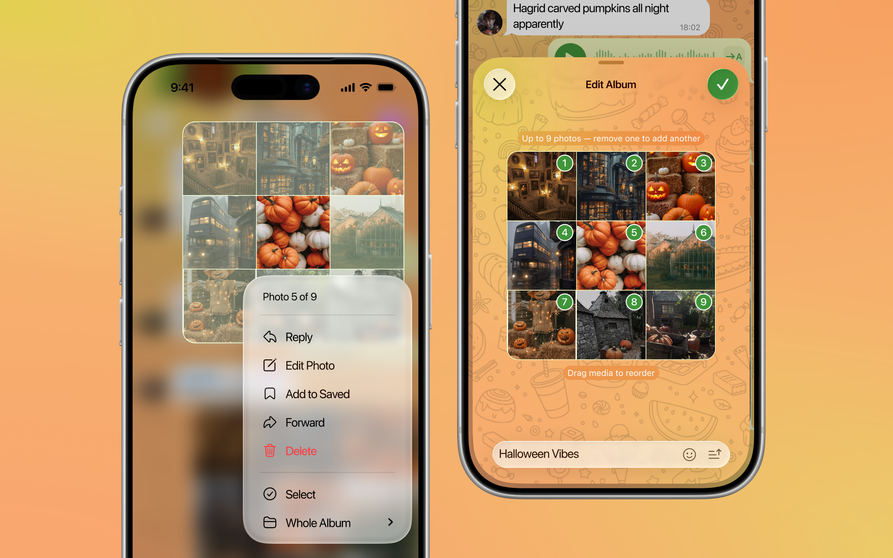
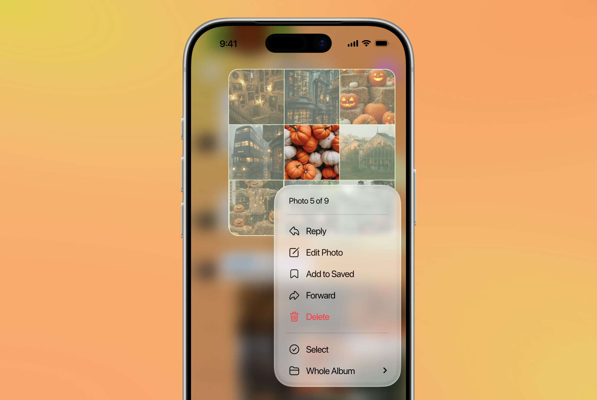
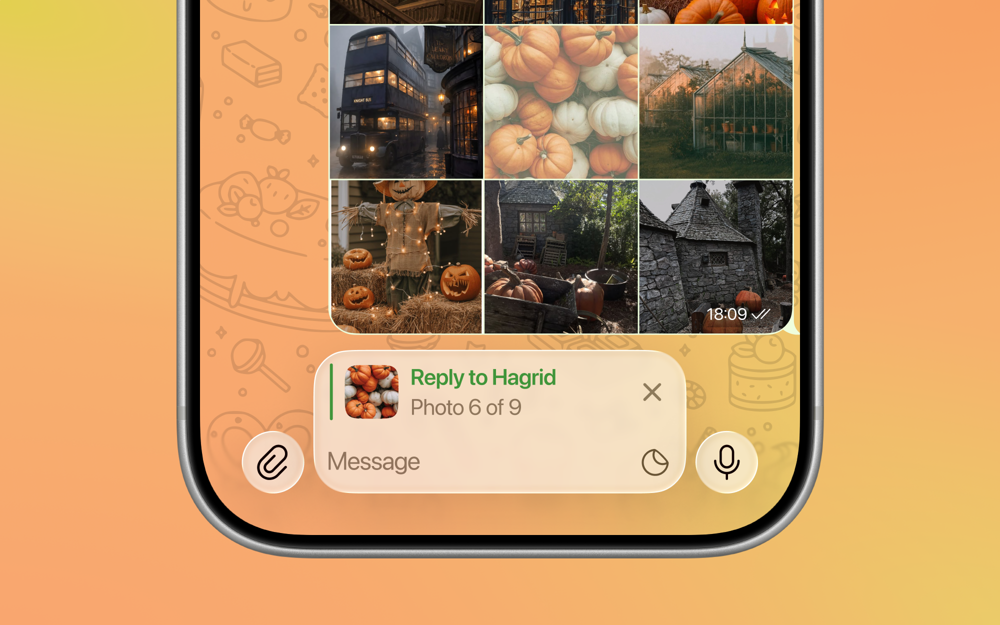
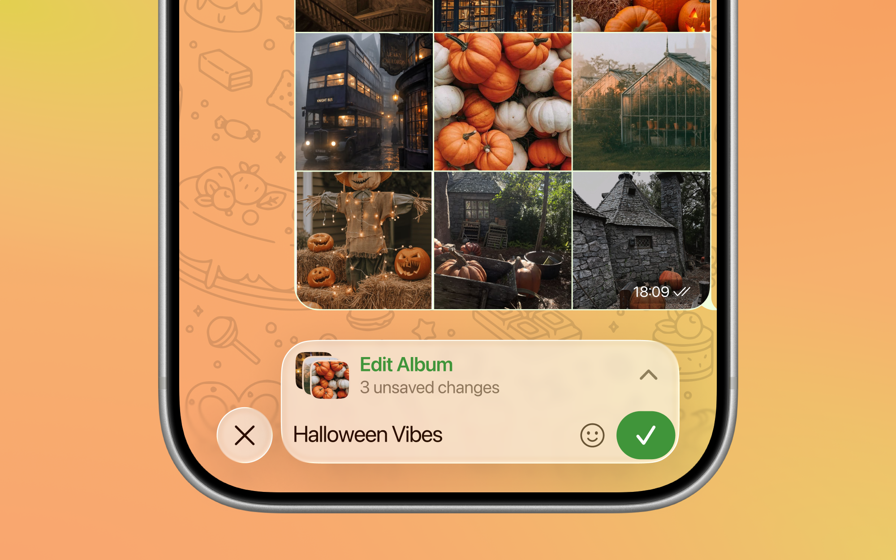
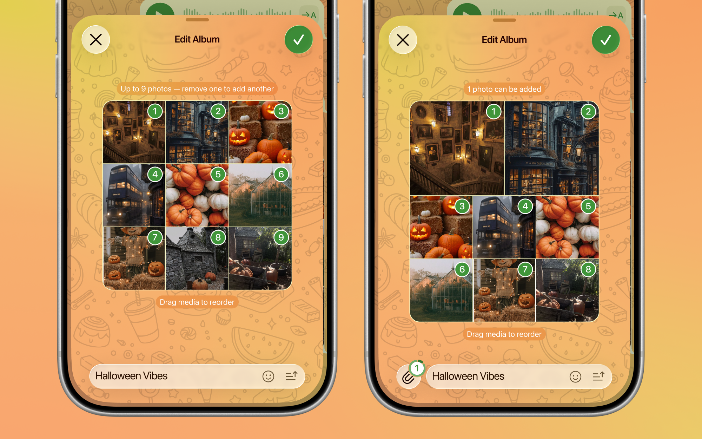

# Per-photo interaction and album editing for Telegram iOS

Hold your finger on an album and, without lifting it, pick the photo you need: reply to it, edit it, forward it or save it on its
own. An album that is already sent can also be **edited**: take photos out, add others, change the order and change the caption.



This is an unofficial change to the open-source [Telegram-iOS](https://github.com/TelegramMessenger/Telegram-iOS) client. It is not
affiliated with Telegram.

## What it does

### 1. A menu for one photo

Hold a photo of an album and the album is lifted with that photo marked as active. Without lifting your finger from the screen, slide it
sideways, up or down onto another photo to make that one active instead; the menu changes with it.



Hold anywhere else on the message, such as the edge of the album or the caption, and you get the usual menu of the whole album (see
[Whole Album](#2-whole-album)).

- The reply panel and the edit panel say which photo is meant: **"Photo 4 of 9"**, with the thumbnail of that photo.
- The menu: **Reply**, **Edit Photo**, **Add to Saved**, **Forward**, **Delete**, **Select**, **Whole Album**.
- **Edit Photo** edits the message of that one photo. The thumbnail in the panel follows the photo when it is replaced.
- **Add to Saved** forwards that single photo, without text, to Saved Messages.
- Who may reply, forward or delete, and copy protection, follow the rules of the regular message menu.



### 2. Whole Album

**Whole Album** opens the usual menu of the message, with **Edit Album** in place of Edit. A long press that is not on a photo (for
example on the caption) opens the same menu directly.

Reactions belong to the album as a whole, so they appear only here and not in the menu of one photo. This also keeps the menu from
changing size while the finger moves from photo to photo.

### 3. Moving the finger between photos

The finger that opened the menu does not have to be lifted. Moving it over another photo makes that photo active and rebuilds the
menu for it. Holding the finger still on a photo turns the album into **one photo on a card** in the middle of the screen: moving
the finger up or down by about 70 pt, or sideways by about 40 pt, goes to the next or previous photo.

### 4. Reaching photos of a tall album

An album of many tall photos does not fit on the screen. See [Finger-driven scrolling](#finger-driven-scrolling) below for what was
changed to make every photo reachable.

### 5. Edit Album

**Edit Album** opens a window with the photos of the album.

- Untick a photo to remove it, add photos from the gallery or the camera, change the order, edit the caption and move it above or
  below the pictures.
- When the window is folded away, the pending changes wait in a bar that replaces the input panel until they are saved or discarded.



### 6. Adding photos to an album

An album keeps the places it had, so it can only get photos back after some were taken away.



- The text over the album reads "Up to N photos - remove one to add another" while every place is taken, and "K photos can be added"
  while K places are free.
- The attachment button next to the caption field is hidden until a place is free.
- In the gallery, **Add to Album** stays inactive until a photo is chosen, and chosen photos go only into the free places.
- The "..." menu in this mode has only **Add in High Quality**. There is no timer, schedule, silent sending, Send as Files or spoiler,
  because none of them make sense for an edit of an album.


## Finger-driven scrolling

The standard context menu scrolls lifted content together with its menu, so a finger that is down would simply drag the album. That
is the wrong behaviour while choosing a photo, so while the finger is down on the photos of the lifted album the scrolling is driven
by the finger the other way round:

- A finger that goes **up** brings the photos above it down to it. A finger that goes **down** brings the ones below up. Every photo
  can be reached without lifting the finger.
- The distance moved is the distance of the finger times a factor (0.6 now; 1.0 would be the same distance). This is the number to
  tune.
- The album never goes past either end, with no bounce, so a finger that goes down over the top of the album does not pull it down.
- It applies only to a finger that is down **on the photos** of the lifted album. A touch that starts anywhere else (the menu, the
  rest of the screen) scrolls as usual, and so does everything on the card, in the actions of the whole album, and with no finger down.
- A finger that moves from the photos onto the menu highlights the item under it, and lifting it there runs the item. Going back over
  the photos removes the highlight. A touch that starts on a menu item slides over the menu to choose an item, as in any menu, even
  when the content is taller than the screen.

### How the logic changed

- **The state of the scrolling is derived from the touches that are down, not from events.** An earlier version switched the scrolling
  off on "finger down" and back on at "finger lifted", and a finger that moved at once never produced that last event, which left the
  chat unscrollable. Now a small recognizer sees every touch from its start to its end, takes none of them, and switches the usual
  scrolling off only while a touch that began on a photo is down. It gives it back the moment that touch ends or is cancelled, and a
  timer re-applies the state every 0.1 s as a safety net.
- **The finger that opened the menu and every other finger are handled by different code.** The first one moves the album from its own
  position updates. The others are followed by the recognizer above.
- **Menu highlighting is done explicitly.** The engine's own handling for the finger that opened the menu did not work every time, so
  highlighting the item under a window point and running it on lift are separate calls.
- **The scrolling state is decided at the start of a touch.** A touch that is already down when the scroller is switched on or off is
  not affected, because a scroller starts only from a new touch.

### Engine API this needed

Four methods were added to the context menu controller and carried through to its presentation node (other presentation nodes get a
no-op default):

| Method | Purpose |
|---|---|
| `setContentScrollingDriven(_:menuSelection:)` | Stops the finger from scrolling the lifted content. With `menuSelection`, a finger that is down can slide over the menu even if the content is taller than the screen. |
| `scrollContent(by:)` | Moves the content by a distance, clamped to both ends, no bounce. |
| `highlightMenu(atWindowPoint:)` | Highlights the menu item under a window point (nothing for nil). |
| `finishMenuHighlight(performAction:)` | Runs the highlighted item, or only drops the highlight. |

## How an album is edited

An album is a set of ordinary messages that share a `grouped_id`, and the order of a photo is the order of its message. The API does
not allow adding a message to an album that is already sent, moving a message inside it, or changing the whole album in one step. It
does allow deleting one message, editing one message (its media and text), and sending a new album.

So an album keeps its **fixed places**, and what the user leaves in the window is turned into the smallest set of operations the
server allows:

- Messages whose photo is no longer wanted are deleted. Which ones is chosen by trying every choice and taking the one that needs the
  fewest edits, so removing one photo from the middle with no other change is a single deletion.
- A message that has to show another photo gets it through an edit of its media. A photo that was added is uploaded; a photo that comes
  from another message of the album is sent as a copy of its local file, not by a reference, because that message may be edited at the
  same moment.
- Moving a photo is the same thing: the two messages involved are edited to show each other's photo.
- The caption stays on the message that had it, or moves to the last remaining one.

Nothing is ever sent as a new album, so reactions, replies and the position of the album in the history are kept.

Added photos are uploaded at 1280 px on the long side, or 2560 px with **Add in High Quality**.

## Limitations

- A reorder or replacement is a set of independent media edits. Other users see the photos change one by one, not move.
- Each edit is its own request. If one fails, the album is left half changed.
- Photos that change places are uploaded again.
- The album can never have more photos than it had. At least one photo has to stay.
- Edits made in the full-screen gallery (crop, filters, captions) and the spoiler option are not carried into an album.
- An audio file added in the window is not saved (photos and audio cannot be in one album).

## What would make it better: server changes

The workaround exists only because the album cannot be changed as one thing. With server support it would be one atomic, cheap
operation:

- **Append to an album**: let `sendMedia` / `sendMultiMedia` take the `grouped_id` of an existing album, so the limit of fixed places
  goes away.
- **Reorder**: a method that takes the album's message ids in their new order, so photos move without being uploaded again.
- **One call for the whole edit**: for example `messages.editMultiMedia`, taking the final list of media, the caption and its
  position, applied atomically and delivered to other clients as a single update.
- Keeping the identity of the messages (reactions, replies, position in the history) when an album is changed.

## Applying the change

`changes.patch` is the difference from the official Telegram-iOS master at commit `fb0e62ba8a`. From a checkout of that commit:

```
git apply --check changes.patch
git apply changes.patch
```

Then build as described in the Telegram-iOS README. The patch touches the context menu engine, the attachment and media picker
modules and the chat input panels, and adds the album files under `submodules/TelegramUI/Sources/` and two notes under `docs/`.
